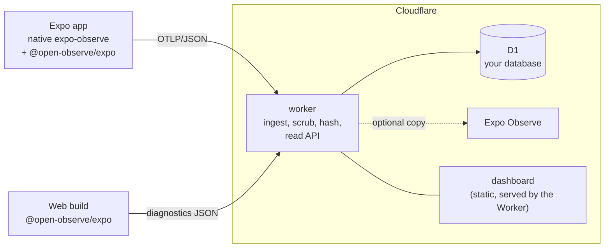

# open-observe

An open replacement for Expo Observe with **your own backend** and a **backward-compatible API**. Self-hosted app
observability for Expo apps on Cloudflare: the telemetry stays in your own D1 database (app startup and screen timings, Web
Vitals, errors and crashes, events, navigation, update adoption and network traces), with a dashboard that has the same
seven tabs.

## Philosophy

- **Open replacement, not a new product.** An app that uses Expo Observe should be able to switch to open-observe, and back,
  by changing configuration and not code.
- **Your own backend.** The server is a small Cloudflare Worker plus a D1 database in your account. Nothing leaves it unless you
  turn on the optional copy to Expo.
- **Backward-compatible API, on both sides.** The client package keeps the exports and types of `expo-observe`. The Worker
  accepts the protocol that the native `expo-observe` module already sends. Anything new is additive (see
  [`docs/COMPATIBILITY.md`](docs/COMPATIBILITY.md)); a change that would break an existing app does not ship.

> Not affiliated with or endorsed by Expo. Expo and Expo Observe are trademarks of 650 Industries, Inc.



| Part | What it is | Folder |
|---|---|---|
| `@open-observe/expo` | The client: a drop-in replacement of `expo-observe` (same exports and types), plus a real web collector (Web Vitals, errors) and an on/off gate. | [`packages/expo`](packages/expo) |
| Worker | Cloudflare Worker with D1: OTLP ingest compatible with native `expo-observe`, scrubbing and hashing of identifiers, rate limit, retention, optional forward to Expo, the read API. | [`worker`](worker) |
| Dashboard | Static web dashboard (no framework runtime beyond a small UI library): Overview, Navigation, Updates, Metrics, Errors, Events, Traces. Token login. | [`dashboard`](dashboard) |

## Quick start

1. **Deploy the server** (about ten minutes, a free Cloudflare plan is enough for small apps): follow [`worker/README.md`](worker/README.md).
   It creates a D1 database, sets two secrets (`ADMIN_TOKEN`, `PEPPER`), lists your Expo project id in `PROJECT_IDS`, and deploys the Worker together with the dashboard.
2. **Point the native module at it** with `extra.eas.observe.endpointUrl` in `app.json` (a new build is needed, it is not an OTA setting).
3. **Use the JS/web package** (optional, for web diagnostics and the on/off gate): `npm install @open-observe/expo` and import from it instead of `expo-observe`. See [`packages/expo/README.md`](packages/expo/README.md).
4. Open the Worker's URL and sign in with the admin token.

## Privacy by design

- No IP address, no User-Agent and no account are stored. Client and session ids are truncated HMACs with a secret you own (`PEPPER`).
- Routes are templates (`/items/[id]`), never real URLs. Error messages and stacks are scrubbed (addresses, tokens, e-mail addresses, numbers) before they are stored.
- Event names and attributes pass an allow-list. Apps decide which events exist; free text and identifiers are dropped.
- Raw rows are deleted after the retention period (default 30 days).
- The data lives in your Cloudflare account, in the region you choose for D1.

See the part READMEs for exactly what is and is not stored.

## Compatibility

`@open-observe/expo` is checked against the installed `expo-observe` on every test run: each export of the original must exist in both the native and the web entry with an assignable type, so you can switch between the two without touching your imports. The Worker accepts the OTLP that native `expo-observe` sends, so apps that already use `expo-observe` need only a new `endpointUrl`.

## Development

Each part is independent and has its own tests:

```sh
(cd packages/expo && npm install && npm test)
(cd worker && npm install && npm test)
(cd dashboard && npm install && npm test)
```

`npm run test:all` at the root runs the three in a row (after the installs).

## Origin and licence

open-observe grew out of the self-hosted telemetry of a production Expo app. The client package contains a modified copy of the JavaScript sources of `expo-observe` (MIT, Copyright (c) 2015-present 650 Industries, Inc.); see [`NOTICE`](NOTICE) and [`packages/expo/NOTICE`](packages/expo/NOTICE). Everything is released under the [MIT licence](LICENSE).
